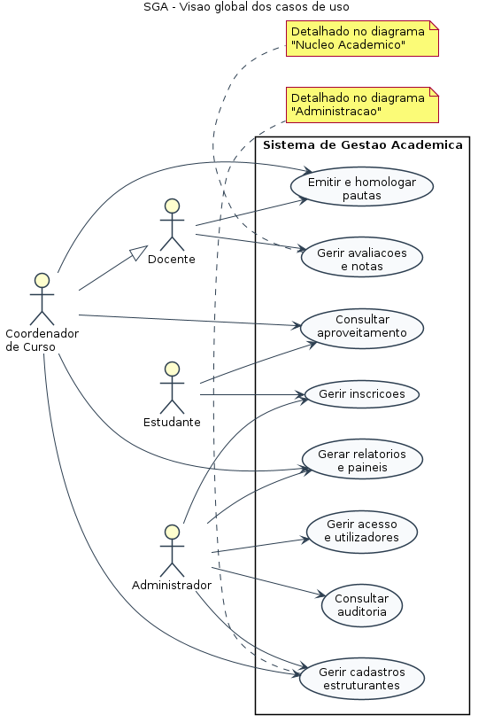
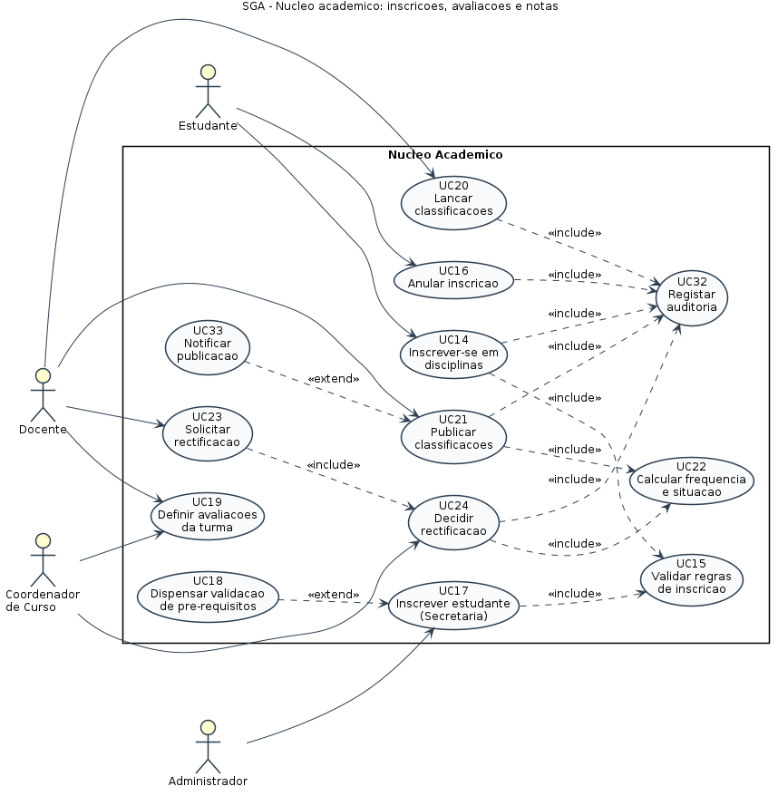
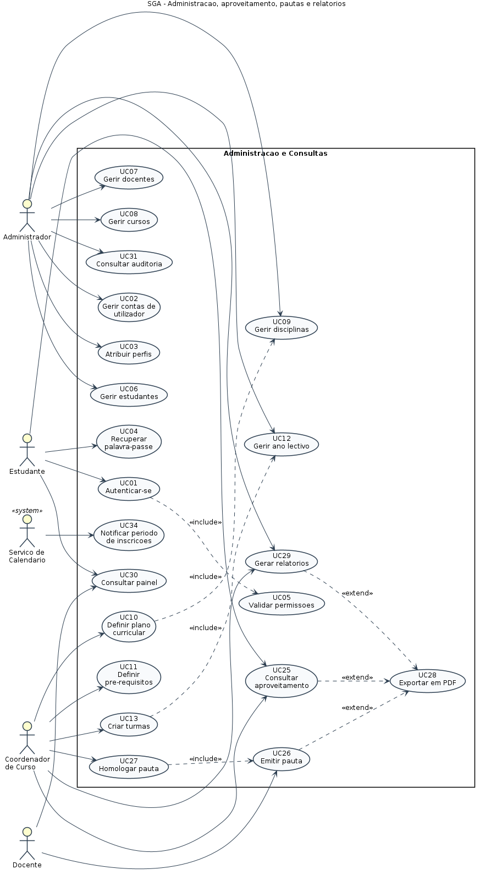
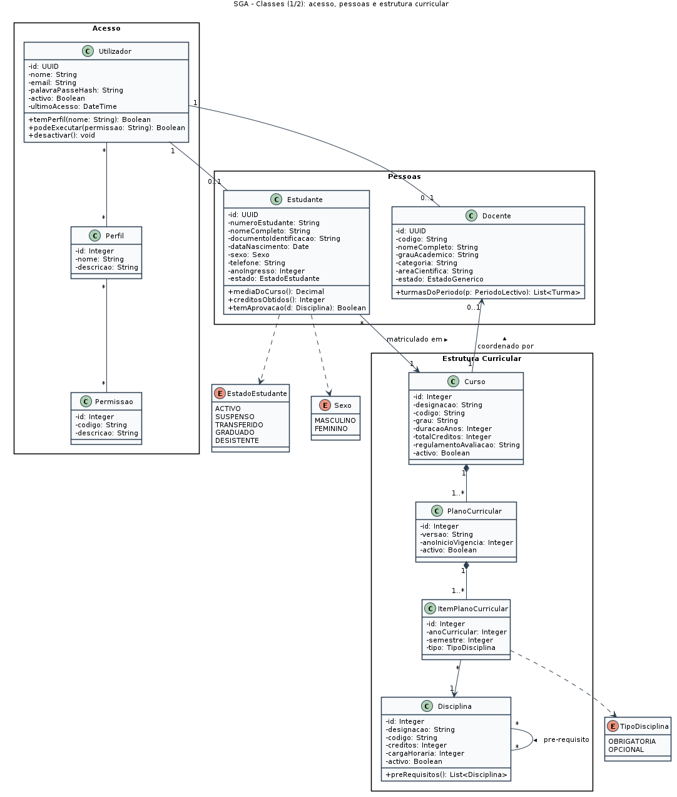
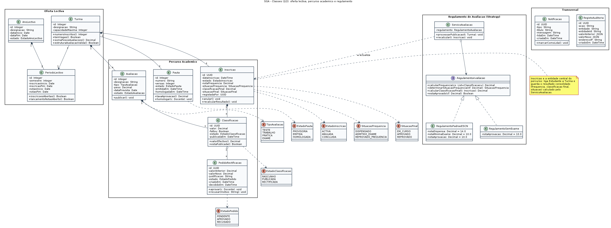
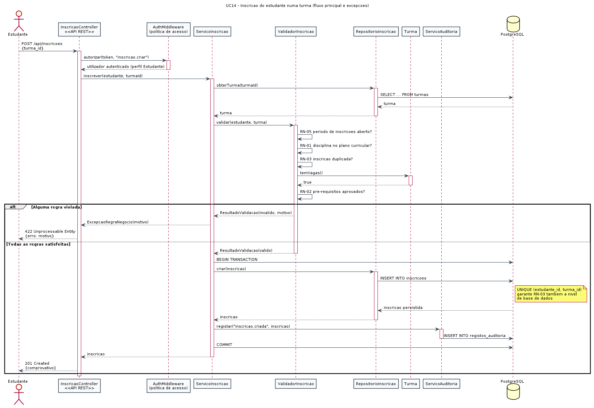
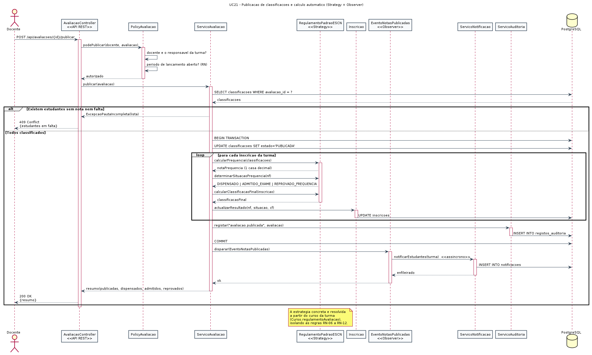
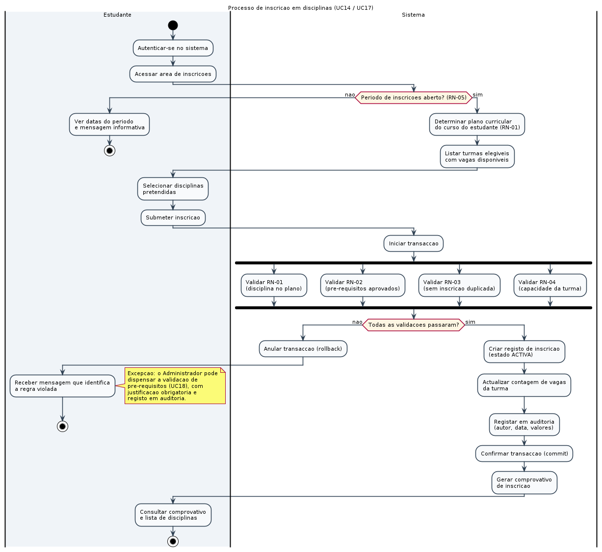
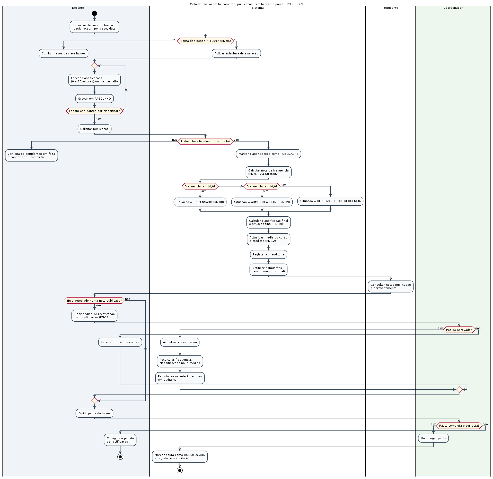
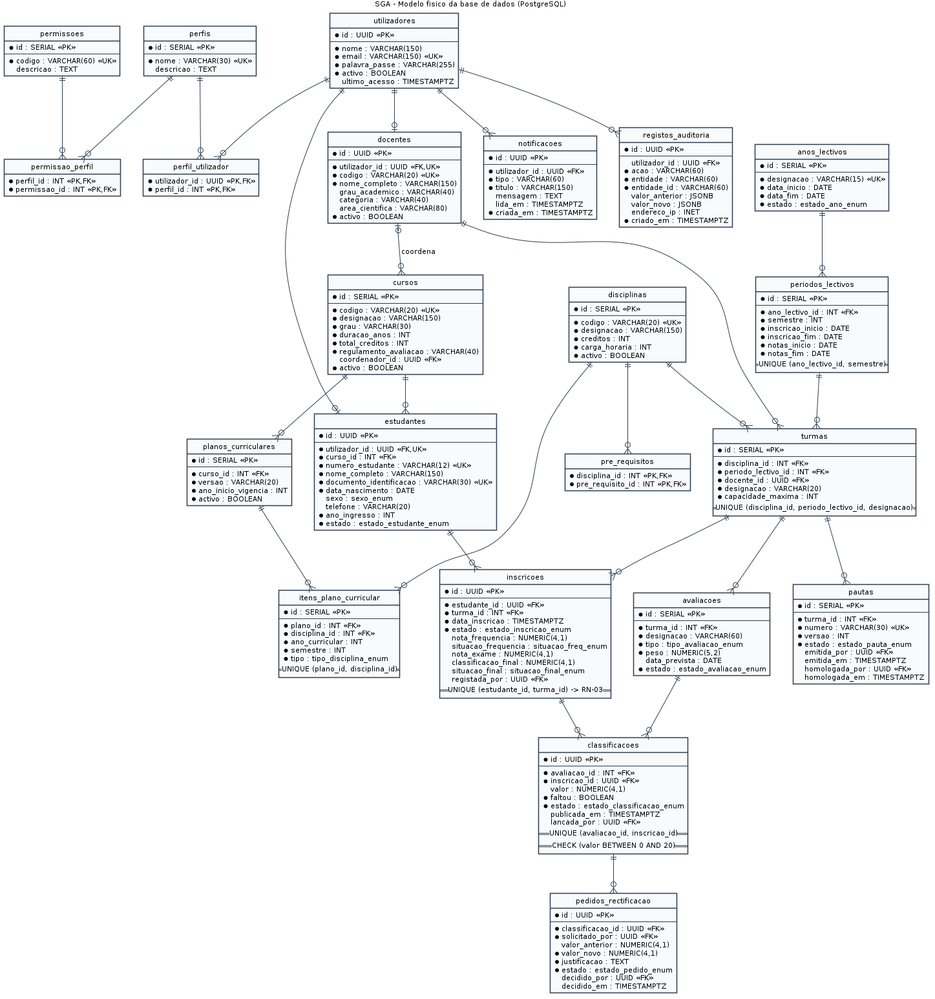

# Fase 2 — Modelação

**Projecto 2 — Sistema de Gestão Académica (SGA)**
Escola Superior de Ciências Náuticas — Engenharia de Software
Curso: Programação de Sistemas Informáticos e de Telecomunicações
Grupo 2 — 3 estudantes | Maputo, 2026

Entrega correspondente ao período **01/09 – 10/09** do cronograma da disciplina.
Baseia-se nos requisitos e User Stories definidos na Fase 1.

---

## Índice

1. [Objectivo e âmbito da fase](#1-objectivo-e-âmbito-da-fase)
2. [Decisões de modelação e respectiva justificação](#2-decisões-de-modelação-e-respectiva-justificação)
3. [Diagrama de Casos de Uso](#3-diagrama-de-casos-de-uso)
4. [Especificação detalhada de casos de uso](#4-especificação-detalhada-de-casos-de-uso)
5. [Diagrama de Classes](#5-diagrama-de-classes)
6. [Diagramas de Sequência](#6-diagramas-de-sequência)
7. [Diagramas de Actividades](#7-diagramas-de-actividades)
8. [Modelo da base de dados](#8-modelo-da-base-de-dados)
9. [Dicionário de dados](#9-dicionário-de-dados)
10. [Verificação das regras de negócio](#10-verificação-das-regras-de-negócio)
11. [Rastreabilidade Fase 1 → Fase 2](#11-rastreabilidade-fase-1--fase-2)
12. [Ficheiros entregues e reprodução dos diagramas](#12-ficheiros-entregues-e-reprodução-dos-diagramas)
13. [Questões abertas para a Fase 3](#13-questões-abertas-para-a-fase-3)

---

## 1. Objectivo e âmbito da fase

Esta fase traduz os requisitos da Fase 1 num modelo de software: o que o sistema faz
(casos de uso), de que é feito (classes), como se comporta no tempo (sequência), como
decorrem os processos de negócio (actividades) e como a informação é persistida (modelo da
base de dados).

Artefactos exigidos pelo enunciado e respectiva localização:

| Artefacto obrigatório | Entregue em | Secção |
|---|---|---|
| Diagrama de Casos de Uso | `diagramas/01`, `02`, `03` | 3 |
| Diagrama de Classes | `diagramas/04`, `05` | 5 |
| Diagrama de Sequência | `diagramas/06`, `07` | 6 |
| Diagrama de Actividades | `diagramas/08`, `09` | 7 |
| Modelo da base de dados | `diagramas/10` + `schema.sql` | 8 |

Todos os diagramas foram produzidos em **PlantUML**, mantendo o código-fonte (`.puml`) no
repositório. Esta opção é deliberada: os diagramas ficam sob controlo de versões, com
histórico de alterações e diferenças legíveis em cada *commit*, ao contrário de imagens
produzidas em ferramentas gráficas.

---

## 2. Decisões de modelação e respectiva justificação

Sete decisões estruturam todo o modelo. Cada uma é justificada porque será questionada
durante a defesa.

### D1 — A entidade **Turma** (oferta lectiva) é o centro da modelação

O enunciado refere apenas "disciplinas". Modelar a inscrição como uma ligação directa entre
`Estudante` e `Disciplina` tornaria impossível, contudo, responder a perguntas elementares:
em que ano lectivo o estudante frequentou a disciplina? Qual o docente que a regeu? Que nota
obteve na primeira tentativa e na segunda?

Introduziu-se por isso a entidade `Turma`, que representa a oferta de uma disciplina num
período lectivo, com docente responsável e capacidade máxima:

```
Disciplina (o que se ensina, definição estável no plano curricular)
    └── Turma (quando, por quem e com que capacidade se ensina)
            └── Inscrição (quem frequenta, com que resultado)
                    └── Classificação (nota em cada avaliação)
```

**Consequência:** o histórico académico completo passa a ser obtido pela leitura das
inscrições de um estudante, e a repetição de uma disciplina em anos diferentes é
representada naturalmente por duas inscrições em turmas distintas.

### D2 — A **Inscrição** guarda o resultado consolidado

A nota de frequência, a situação de frequência, a classificação final e a situação final são
atributos da `Inscricao`, calculados e persistidos, e não valores calculados a cada consulta.

**Justificação:** (i) o desempenho das consultas de aproveitamento e dos relatórios, que
percorrem centenas de milhares de registos, seria inaceitável com recálculo permanente
(RNF-01, RNF-03); (ii) a classificação final é um dado com valor oficial — deve poder
ser reproduzida exactamente tal como foi comunicada ao estudante, mesmo que o regulamento
de avaliação venha a ser alterado.

**Risco assumido:** desnormalização controlada. Mitigação: o recálculo está concentrado num
único serviço (`ServicoAvaliacao`), invocado na publicação de notas e em cada rectificação
aprovada (RF-50); nenhuma outra parte do sistema escreve nestes campos.

### D3 — Regulamento de avaliação como **Strategy**

As regras RN-06 a RN-12 (pesos, dispensa, admissão a exame, aprovação, média ponderada)
são as mais voláteis do domínio e variam de curso para curso. Foram encapsuladas na
interface `RegulamentoAvaliacao`, com implementações concretas (`RegulamentoPadraoESCN`,
`RegulamentoSemExame`) escolhidas a partir do campo `cursos.regulamento_avaliacao`.

**Benefício:** acrescentar um regulamento não exige alterar o código do serviço de avaliação
(princípio aberto/fechado); os limiares numéricos ficam num único lugar, testável em
isolamento.

### D4 — Notas publicadas são **imutáveis**; a correcção é um novo objecto de domínio

Uma classificação publicada não é editável. A correcção exige um `PedidoRectificacao`, com
justificação e decisão do Coordenador (RN-11). O pedido é uma entidade do domínio, não uma
simples operação de escrita.

**Justificação:** a alteração de uma nota é o acto de maior risco do sistema. Transformá-la
num objecto com estado (pendente, aprovado, recusado) dá-lhe autor, motivo, aprovador e
data — exactamente o que o problema P5 da Fase 1 identificou como ausente.

### D5 — Chaves primárias `UUID` nas entidades com dados pessoais

`utilizadores`, `estudantes`, `docentes`, `inscricoes`, `classificacoes` e
`pedidos_rectificacao` usam `UUID`; as entidades de configuração (cursos, disciplinas,
turmas, anos lectivos) usam `SERIAL`.

**Justificação:** identificadores sequenciais em recursos da API permitem enumeração
(`/api/estudantes/1`, `/2`, `/3`…), o que facilita o acesso indevido e a inferência de
volumes. O `UUID` elimina esse vector (RNF-12). Nas tabelas de configuração, cujos dados
não são sensíveis, o `SERIAL` é preferível pelo desempenho dos índices e pela legibilidade.

### D6 — Eliminação lógica em vez de eliminação física

Estudantes, docentes, cursos e disciplinas não são eliminados: são inactivados
(`activo`/`estado`). RF-12 exige-o explicitamente para estudantes com histórico.

**Justificação:** a eliminação de um estudante destruiria as suas classificações por
propagação de chave estrangeira, apagando registos com valor oficial. A única entidade
verdadeiramente removível é a inscrição — e mesmo essa passa ao estado `ANULADA` em vez de
desaparecer.

### D7 — Auditoria como tabela apenas de escrita

`registos_auditoria` recebe inserções, nunca actualizações ou eliminações. A restrição é
imposta por *trigger* na base de dados, e não apenas pela ausência de *endpoints*.

**Justificação:** RNF-32 exige imutabilidade. Uma restrição garantida somente na camada de
aplicação é contornável por qualquer acesso directo à base de dados — o que é precisamente
o cenário em que a auditoria mais importa.

---

## 3. Diagrama de Casos de Uso

Os casos de uso foram distribuídos por três diagramas em vez de um único. Um diagrama com
34 casos de uso e 5 actores torna-se ilegível em papel; a decomposição por subsistema é
prática corrente e mantém a rastreabilidade através da numeração contínua UC01–UC34.

### 3.1. Visão global



### 3.2. Núcleo académico — inscrições, avaliações e notas



### 3.3. Administração, aproveitamento, pautas e relatórios



### 3.4. Actores

| Actor | Natureza | Descrição |
|---|---|---|
| Estudante | Humano, primário | Inscreve-se e consulta o seu percurso académico |
| Docente | Humano, primário | Gere avaliações e classificações das suas turmas |
| Coordenador de Curso | Humano, primário | Especialização de Docente: acrescenta a coordenação do curso, a homologação de pautas e a decisão sobre rectificações |
| Administrador | Humano, primário | Secretaria Académica e TI: gere cadastros, utilizadores e ano lectivo |
| Serviço de Calendário | Sistema, secundário | Processo automático que dispara notificações associadas às datas dos períodos lectivos |

A generalização `Coordenador --|> Docente` traduz uma realidade da instituição: o
coordenador é um docente e mantém as suas turmas. No sistema, isso corresponde a um
utilizador com dois perfis, o que o modelo de acesso permite (relação muitos-para-muitos
entre `Utilizador` e `Perfil`).

### 3.5. Relações `include` e `extend`

| Relação | Tipo | Fundamento |
|---|---|---|
| UC14 → UC15 (validar regras de inscrição) | `include` | Comportamento obrigatório e reutilizado também por UC17 |
| UC21 → UC22 (calcular frequência e situação) | `include` | A publicação desencadeia sempre o cálculo |
| UC14/UC20/UC21/UC24 → UC32 (registar auditoria) | `include` | Toda a operação sensível é auditada, sem excepção |
| UC18 → UC17 (dispensar validação de pré-requisitos) | `extend` | Comportamento excepcional, apenas por decisão administrativa justificada |
| UC26/UC29/UC25 → UC28 (exportar em PDF) | `extend` | Opcional: a consulta é válida sem exportação |
| UC33 → UC21 (notificar publicação) | `extend` | Extensão opcional do projecto; a publicação não depende dela |

---

## 4. Especificação detalhada de casos de uso

Especificam-se os três casos de uso de maior risco. Os restantes seguem o mesmo formato e
constam do anexo do relatório final.

### UC14 — Inscrever-se em disciplinas

| Campo | Conteúdo |
|---|---|
| **Actor principal** | Estudante |
| **Actores secundários** | — |
| **Requisitos** | RF-29, RF-30, RF-33 |
| **User Story** | US-13 |
| **Pré-condições** | Estudante autenticado, com estado `ACTIVO`; existe um ano lectivo `ACTIVO`; o período de inscrições do semestre está aberto |
| **Pós-condições (sucesso)** | Inscrição criada com estado `ACTIVA`; vaga da turma consumida; registo de auditoria criado; comprovativo disponível |
| **Regras aplicáveis** | RN-01, RN-02, RN-03, RN-04, RN-05 |

**Fluxo principal**

1. O estudante acede à área de inscrições.
2. O sistema verifica que o período de inscrições está aberto (RN-05).
3. O sistema determina o plano curricular do curso do estudante e lista as turmas
   elegíveis com vagas disponíveis (RN-01, RN-04).
4. O estudante selecciona uma ou mais disciplinas e submete.
5. O sistema abre uma transacção e valida RN-01 a RN-04 para cada selecção.
6. O sistema cria as inscrições no estado `ACTIVA`.
7. O sistema registra a operação na auditoria e confirma a transacção.
8. O sistema apresenta o comprovativo com a lista das disciplinas, a data e a hora.

**Fluxos alternativos e de excepção**

| ID | Condição | Comportamento |
|---|---|---|
| A1 | Período de inscrições encerrado | Apresenta as datas do período; nenhuma acção de inscrição disponível |
| A2 | Disciplina fora do plano curricular | Recusa com identificação da disciplina (RN-01) |
| A3 | Pré-requisito não aprovado | Recusa indicando a disciplina em falta (RN-02) |
| A4 | Inscrição já existente | Recusa por duplicação (RN-03) |
| A5 | Capacidade da turma esgotada | Recusa; turma apresentada como sem vagas (RN-04) |
| A6 | Falha na persistência | Transacção anulada (*rollback*); nenhuma inscrição parcial subsiste |
| A7 | Duas inscrições concorrentes na última vaga | A verificação com bloqueio de linha na base de dados garante que apenas uma é aceite |

### UC21 — Publicar classificações

| Campo | Conteúdo |
|---|---|
| **Actor principal** | Docente |
| **Requisitos** | RF-39, RF-44, RF-45, RF-46, RF-61 |
| **User Story** | US-18, US-20 |
| **Pré-condições** | Docente responsável pela turma; estrutura de avaliação válida (soma dos pesos igual a 100%); período de lançamento de notas aberto |
| **Pós-condições (sucesso)** | Classificações no estado `PUBLICADA`; nota de frequência, situação de frequência, classificação final e situação final actualizadas em todas as inscrições da turma; auditoria registada; notificações enfileiradas |
| **Regras aplicáveis** | RN-06 a RN-10 |

**Fluxo principal**

1. O docente solicita a publicação das classificações de uma avaliação.
2. O sistema confirma que o docente é o responsável da turma e que o período de lançamento
   está aberto.
3. O sistema verifica que todos os estudantes inscritos têm classificação ou marca de falta.
4. O sistema abre uma transacção e marca as classificações como `PUBLICADA`.
5. Para cada inscrição, o sistema invoca o regulamento de avaliação aplicável e calcula a
   nota de frequência, a situação de frequência e a classificação final.
6. O sistema registra a publicação na auditoria e confirma a transacção.
7. O sistema dispara, de forma assíncrona, as notificações aos estudantes (extensão).
8. O sistema apresenta ao docente o resumo: publicadas, dispensados, admitidos a exame e
   reprovados por frequência.

**Fluxos alternativos e de excepção**

| ID | Condição | Comportamento |
|---|---|---|
| A1 | Estudantes sem classificação nem marca de falta | Alerta com a lista dos estudantes em falta; publicação exige confirmação |
| A2 | Soma dos pesos diferente de 100% | Publicação recusada (RN-06) |
| A3 | Período de lançamento encerrado | Publicação recusada com indicação das datas |
| A4 | Docente não responsável pela turma | Resposta 403; tentativa registada |
| A5 | Falha no envio das notificações | A publicação mantém-se válida; o envio é reprocessado pela fila |

### UC24 — Decidir pedido de rectificação

| Campo | Conteúdo |
|---|---|
| **Actor principal** | Coordenador de Curso |
| **Requisitos** | RF-40, RF-50, RF-61 |
| **User Story** | US-19 |
| **Pré-condições** | Existe um pedido no estado `PENDENTE` relativo a uma turma do curso coordenado |
| **Pós-condições (aprovação)** | Classificação actualizada e marcada como `RECTIFICADA`; médias e situações recalculadas; auditoria com valor anterior, valor novo, justificação e ambos os intervenientes |
| **Pós-condições (recusa)** | Classificação inalterada; pedido no estado `RECUSADO` com motivo; docente informado |
| **Regras aplicáveis** | RN-11, RN-07 a RN-12 (recálculo) |

**Fluxo principal**

1. O coordenador consulta os pedidos pendentes do seu curso.
2. O sistema apresenta o valor actual, o valor proposto e a justificação do docente.
3. O coordenador aprova o pedido.
4. O sistema actualiza a classificação e marca-a como `RECTIFICADA`.
5. O sistema recalcula a nota de frequência, a classificação final, a situação e a média do
   curso do estudante.
6. O sistema registra na auditoria os valores anterior e novo, a justificação e os dois
   intervenientes.
7. O sistema notifica o docente e o estudante da alteração.

**Fluxos alternativos**

| ID | Condição | Comportamento |
|---|---|---|
| A1 | Coordenador recusa o pedido | Estado `RECUSADO` com motivo obrigatório; nota inalterada |
| A2 | Pauta já homologada | A rectificação obriga à emissão de nova versão da pauta (RF-54) |
| A3 | Pedido sobre turma de outro curso | Resposta 403 |

---

## 5. Diagrama de Classes

O modelo de domínio foi repartido em dois diagramas por razões de legibilidade: um cobre o
acesso, as pessoas e a estrutura curricular; o outro cobre a oferta lectiva, o percurso
académico e o regulamento de avaliação.

### 5.1. Acesso, pessoas e estrutura curricular



### 5.2. Oferta lectiva, percurso académico e regulamento



### 5.3. Notas sobre relações e multiplicidades

| Relação | Multiplicidade | Tipo | Observação |
|---|---|---|---|
| `Utilizador` – `Perfil` | `*` – `*` | associação | Permite um utilizador Docente e Coordenador simultaneamente |
| `Utilizador` – `Estudante` / `Docente` | `1` – `0..1` | associação | A conta é separada da pessoa: um utilizador pode não ser nenhuma das duas (Administrador) |
| `Curso` – `PlanoCurricular` | `1` – `1..*` | composição | O plano não existe sem o curso; a multiplicidade `*` suporta versionamento (RF-22) |
| `PlanoCurricular` – `ItemPlanoCurricular` | `1` – `1..*` | composição | O item é parte indissociável do plano |
| `Disciplina` – `Disciplina` | `*` – `*` | auto-associação | Pré-requisitos; a ausência de ciclos é validada no domínio |
| `AnoLectivo` – `PeriodoLectivo` | `1` – `2` | composição | Dois semestres por ano lectivo (premissa PR-01) |
| `Turma` – `Inscricao` | `1` – `*` | composição | A inscrição não existe sem turma |
| `Inscricao` – `Classificacao` | `1` – `*` | composição | Uma classificação por avaliação da turma |
| `Classificacao` – `PedidoRectificacao` | `1` – `*` | agregação | O pedido sobrevive à classificação como registo histórico |
| `ServicoAvaliacao` – `RegulamentoAvaliacao` | `1` – `1` | agregação | A estratégia é injectada, não instanciada internamente |

### 5.4. Padrões de desenho visíveis no modelo

| Padrão | Onde | Problema que resolve |
|---|---|---|
| **Strategy** | `RegulamentoAvaliacao` e implementações | Isola as regras de cálculo voláteis, permitindo regulamentos distintos por curso |
| **Observer** | `EventoNotasPublicadas` → `ServicoNotificacao` | Desacopla a publicação de notas do envio de notificações; a falha no envio não afecta a publicação |
| **Repository** | `RepositorioInscricao` e restantes | Separa o domínio do mecanismo de persistência, permitindo testar as regras sem base de dados |
| **Service Layer** | `ServicoInscricao`, `ServicoAvaliacao` | Concentra os casos de uso que coordenam várias entidades, mantendo os controladores finos |

A justificação completa e a escolha do padrão obrigatório do enunciado serão desenvolvidas
na Fase 3 (Arquitectura e Design).

---

## 6. Diagramas de Sequência

### 6.1. UC14 — Inscrição do estudante numa turma



Aspectos a destacar:

- A autorização ocorre **antes** de qualquer acesso ao domínio, num filtro próprio, e é
  verificada no servidor (RNF-08, RNF-10).
- As validações RN-01 a RN-05 estão concentradas num único colaborador
  (`ValidadorInscricao`) e não dispersas pelo controlador — o que permite testá-las
  isoladamente.
- Persistência, auditoria e confirmação decorrem na mesma transacção (RNF-16): se a
  auditoria falhar, a inscrição não subsiste.
- A restrição `UNIQUE (estudante_id, turma_id)` duplica a validação RN-03 ao nível da base
  de dados. A redundância é intencional: protege contra pedidos concorrentes que a
  validação em memória não detecta.

### 6.2. UC21 — Publicação de classificações e cálculo automático



Aspectos a destacar:

- O `ServicoAvaliacao` desconhece as regras concretas: delega-as na estratégia obtida a
  partir do curso (Strategy em funcionamento).
- O ciclo de recálculo percorre as inscrições da turma dentro da transacção; a notificação
  é disparada **após** a confirmação e de forma assíncrona (Observer), pelo que uma falha
  no envio não anula a publicação.
- A resposta devolve um resumo agregado, e não a lista completa de notas, evitando tráfego
  desnecessário em ligações de baixa largura de banda (RNF-05).

---

## 7. Diagramas de Actividades

### 7.1. Processo de inscrição em disciplinas



As quatro validações são apresentadas em `fork`/`join` por serem independentes entre si: o
sistema avalia todas e devolve o conjunto das regras violadas, em vez de interromper na
primeira falha. Do ponto de vista da usabilidade (RNF-21), isto evita que o estudante
descubra os impedimentos um a um, em submissões sucessivas.

### 7.2. Ciclo de avaliação: lançamento, publicação, rectificação e pauta



O diagrama usa raias (*swimlanes*) para tornar explícita a separação de responsabilidades
que sustenta o controlo interno do processo: o docente lança e propõe, o sistema calcula e
audita, o coordenador autoriza e homologa. Nenhum actor executa isoladamente o ciclo
completo de alteração de uma nota — o que responde directamente ao problema P5 da Fase 1.

---

## 8. Modelo da base de dados

### 8.1. Modelo físico



São 20 tabelas: 3 de acesso e 2 de associação, 2 de pessoas, 5 de estrutura curricular, 3 de
oferta lectiva, 4 de percurso académico (incluindo pautas) e 2 transversais.

### 8.2. Normalização

O modelo está na **terceira forma normal (3FN)**, com uma desnormalização deliberada e
documentada: os campos de resultado em `inscricoes` (nota de frequência, situação,
classificação final) são deriváveis das classificações, mas são persistidos pelas razões
expostas na decisão D2. Não existem grupos repetitivos, dependências parciais nem
dependências transitivas nas restantes tabelas.

### 8.3. Restrições que implementam regras de negócio

| Regra | Implementação na base de dados |
|---|---|
| RN-03 (sem inscrição duplicada) | `UNIQUE (estudante_id, turma_id)` em `inscricoes` |
| RN-04 (capacidade da turma) | *Trigger* `tg_valida_capacidade_turma`, com `SELECT ... FOR UPDATE` para o caso concorrente |
| RN-11 (nota publicada imutável) | *Trigger* `tg_protege_nota_publicada` |
| RF-38 (escala 0–20) | `CHECK (valor BETWEEN 0 AND 20)` em `classificacoes` e `inscricoes` |
| RN-06 (soma dos pesos = 100%) | Validada no domínio; a base de dados garante apenas `peso > 0 AND peso <= 100` |
| US-09 (disciplina única no plano) | `UNIQUE (plano_id, disciplina_id)` |
| US-10 (pré-requisito não reflexivo) | `CHECK (disciplina_id <> pre_requisito_id)`; a detecção de ciclos é feita no domínio |
| US-12 (um só ano lectivo activo) | Índice único parcial `uk_ano_lectivo_activo` |
| US-30 (notificações sem duplicados) | `UNIQUE (utilizador_id, tipo, referencia)` |
| RNF-32 (auditoria imutável) | *Trigger* `tg_auditoria_imutavel` sobre `UPDATE` e `DELETE` |

A repartição entre domínio e base de dados segue um critério explícito: **regras que
dependem de contexto de negócio ou exigem mensagens explicativas ficam no domínio; regras
de integridade estrutural e regras vulneráveis a concorrência ficam também na base de
dados.** A duplicação é assumida onde protege a integridade dos dados.

### 8.4. Índices

| Índice | Objectivo |
|---|---|
| `ix_estudantes_nome` (`lower(nome_completo)`) | Pesquisa insensível a maiúsculas (US-06, RNF-01) |
| `ix_estudantes_curso` | Filtro por curso e estado nas listagens e relatórios |
| `ix_turmas_docente` | Painel do docente: turmas do período |
| `ix_inscricoes_estudante`, `ix_inscricoes_turma` | Aproveitamento e pautas |
| `ix_classificacoes_avaliacao` | Ecrã de lançamento e publicação de notas |
| `ix_notificacoes_nao_lidas` (parcial) | Contador de notificações não lidas |
| `ix_auditoria_entidade`, `ix_auditoria_autor` | Consulta filtrada da auditoria (US-28) |

### 8.5. Vistas de apoio

| Vista | Finalidade |
|---|---|
| `vw_aproveitamento` | Aproveitamento por inscrição, com curso, ano lectivo e disciplina (RF-48, RF-49) |
| `vw_media_curso` | Média ponderada por créditos e créditos obtidos (RN-12) |
| `vw_aproveitamento_disciplina` | Taxas de aprovação e reprovação por disciplina e ano lectivo (RF-55) |

As vistas mantêm a lógica de agregação fora do código da aplicação, garantindo que
relatórios e painéis produzem sempre os mesmos números — ponto em que os processos manuais
descritos na Fase 1 falhavam.

---

## 9. Dicionário de dados

Tabelas principais. O dicionário completo, coluna a coluna, consta de `schema.sql`, onde
cada restrição está comentada.

| Tabela | Finalidade | PK | Restrições determinantes |
|---|---|---|---|
| `utilizadores` | Credenciais e estado da conta | UUID | `UNIQUE (email)`; palavra-passe armazenada apenas como *hash* |
| `perfis`, `permissoes` | Papéis e permissões atómicas | SERIAL | `UNIQUE (nome)`, `UNIQUE (codigo)` |
| `perfil_utilizador` | Atribuição de papéis | composta | Permite acumulação de perfis |
| `estudantes` | Dados académicos do estudante | UUID | `UNIQUE` em número de estudante e documento; FK para curso e plano |
| `docentes` | Dados do docente | UUID | `UNIQUE (codigo)`, `UNIQUE (utilizador_id)` |
| `cursos` | Curso, duração e regulamento aplicável | SERIAL | `regulamento_avaliacao` selecciona a estratégia de cálculo |
| `planos_curriculares` | Versão do plano de estudos | SERIAL | `UNIQUE (curso_id, versao)` |
| `itens_plano_curricular` | Disciplina no ano e semestre curriculares | SERIAL | `UNIQUE (plano_id, disciplina_id)`; `semestre IN (1,2)` |
| `disciplinas` | Definição estável da disciplina | SERIAL | `UNIQUE (codigo)`; `creditos > 0` |
| `pre_requisitos` | Dependências entre disciplinas | composta | `CHECK` de não reflexividade |
| `anos_lectivos` | Ano lectivo e estado | SERIAL | Índice parcial: um único `ACTIVO` |
| `periodos_lectivos` | Semestre e janelas de inscrição e de notas | SERIAL | `UNIQUE (ano_lectivo_id, semestre)` |
| `turmas` | Oferta de uma disciplina num período | SERIAL | `UNIQUE (disciplina_id, periodo_lectivo_id, designacao)` |
| `inscricoes` | Frequência e resultado consolidado | UUID | `UNIQUE (estudante_id, turma_id)`; `CHECK` de escala nas notas |
| `avaliacoes` | Instrumento de avaliação e peso | SERIAL | `peso > 0 AND <= 100` |
| `classificacoes` | Nota ou falta por avaliação | UUID | `UNIQUE (avaliacao_id, inscricao_id)`; `CHECK (0..20)` |
| `pedidos_rectificacao` | Alteração autorizada de nota publicada | UUID | Justificação com pelo menos 20 caracteres |
| `pautas` | Documento emitido e homologado | SERIAL | `UNIQUE (numero)`, `UNIQUE (turma_id, versao)` |
| `notificacoes` | Avisos ao utilizador | UUID | `UNIQUE (utilizador_id, tipo, referencia)` |
| `registos_auditoria` | Registo imutável de operações sensíveis | UUID | Apenas inserções; `JSONB` para valores anterior e novo |

---

## 10. Verificação das regras de negócio

O modelo não ficou apenas desenhado: o script `schema.sql` foi executado em PostgreSQL e as
restrições foram exercitadas com casos positivos e negativos. O resultado obtido:

| # | Cenário testado | Resultado esperado | Obtido |
|---|---|---|---|
| T1 | Inscrição válida em turma com vaga | Aceita | Aceita |
| T2 | Segunda inscrição do mesmo estudante na mesma turma (RN-03) | Recusada | Recusada pela restrição `UNIQUE` |
| T3 | Inscrição em turma com capacidade esgotada (RN-04) | Recusada | Recusada pelo *trigger* de capacidade |
| T4 | Classificação de 21 valores (RF-38) | Recusada | Recusada pelo `CHECK` |
| T5 | Classificação válida e publicação | Aceita | Aceita |
| T6 | Alteração directa de nota publicada (RN-11) | Recusada | Recusada pelo *trigger* de protecção |
| T7 | Alteração via rectificação autorizada | Aceita | Aceita |
| T8 | Pedido de rectificação com justificação de 4 caracteres | Recusada | Recusada pelo `CHECK` |
| T9 | Alteração de registo de auditoria (RNF-32) | Recusada | Recusada pelo *trigger* de imutabilidade |
| T10 | Segundo ano lectivo no estado `ACTIVO` | Recusada | Recusada pelo índice único parcial |
| T11 | Consulta das vistas de aproveitamento e de média | Valores correctos | Valores correctos |

Esta verificação antecipa a Fase 5: as mesmas condições passam a testes automatizados de
integração, transformando cada regra de negócio num teste com nome próprio.

---

## 11. Rastreabilidade Fase 1 → Fase 2

| User Story (Fase 1) | Caso de uso | Classes envolvidas | Tabelas |
|---|---|---|---|
| US-01, US-02, US-03 | UC01, UC02, UC03, UC05 | `Utilizador`, `Perfil`, `Permissao` | `utilizadores`, `perfis`, `permissoes`, `perfil_utilizador`, `permissao_perfil` |
| US-05, US-06 | UC06 | `Estudante`, `Curso` | `estudantes` |
| US-07 | UC07 | `Docente` | `docentes` |
| US-08, US-09, US-10 | UC08, UC10, UC11 | `Curso`, `PlanoCurricular`, `ItemPlanoCurricular`, `Disciplina` | `cursos`, `planos_curriculares`, `itens_plano_curricular`, `pre_requisitos` |
| US-11, US-12 | UC12, UC13 | `AnoLectivo`, `PeriodoLectivo`, `Turma` | `anos_lectivos`, `periodos_lectivos`, `turmas` |
| US-13, US-14, US-15 | UC14, UC15, UC16, UC17, UC18 | `Inscricao`, `ValidadorInscricao`, `ServicoInscricao` | `inscricoes` |
| US-16, US-17, US-18 | UC19, UC20, UC21 | `Avaliacao`, `Classificacao`, `ServicoAvaliacao` | `avaliacoes`, `classificacoes` |
| US-19 | UC23, UC24 | `PedidoRectificacao` | `pedidos_rectificacao` |
| US-20, US-21 | UC22 | `RegulamentoAvaliacao`, `RegulamentoPadraoESCN` | `inscricoes` (campos de resultado) |
| US-22, US-23 | UC25 | `Inscricao`, `Estudante` | `vw_aproveitamento`, `vw_media_curso` |
| US-24, US-25 | UC26, UC27, UC28 | `Pauta`, `Turma` | `pautas` |
| US-26, US-27 | UC29, UC30 | — (consultas agregadas) | `vw_aproveitamento_disciplina` |
| US-28 | UC31, UC32 | `RegistoAuditoria` | `registos_auditoria` |
| US-29, US-30 | UC33, UC34 | `Notificacao`, `ServicoNotificacao` | `notificacoes` |

Nenhuma User Story da Fase 1 ficou sem cobertura, e nenhuma classe ou tabela foi introduzida
sem User Story de origem — com uma excepção justificada: `planos_curriculares` suporta
US-09 e prepara o versionamento (RF-22, classificado como *Could have*).

---

## 12. Ficheiros entregues e reprodução dos diagramas

```
fase2/
├── Fase2_Modelacao_SGA.md          (este documento)
├── schema.sql                      (modelo físico, executado e validado)
└── diagramas/
    ├── 01-casos-de-uso-geral.puml           → casos-de-uso-geral.png|svg
    ├── 02-casos-de-uso-nucleo.puml          → casos-de-uso-nucleo.png|svg
    ├── 03-casos-de-uso-administracao.puml   → casos-de-uso-administracao.png|svg
    ├── 04-classes-estrutura.puml            → classes-estrutura.png|svg
    ├── 05-classes-percurso.puml             → classes-percurso.png|svg
    ├── 06-sequencia-inscricao.puml          → sequencia-inscricao.png|svg
    ├── 07-sequencia-publicacao-notas.puml   → sequencia-publicacao-notas.png|svg
    ├── 08-actividades-inscricao.puml        → actividades-inscricao.png|svg
    ├── 09-actividades-notas.puml            → actividades-notas.png|svg
    └── 10-modelo-base-dados.puml            → modelo-base-dados.png|svg
```

**Regenerar os diagramas** (Ubuntu):

```bash
sudo apt install plantuml graphviz
cd diagramas
plantuml -charset UTF-8 -tpng *.puml     # imagens para o relatório
plantuml -charset UTF-8 -tsvg *.puml     # versão vectorial, para ampliar sem perda
```

**Criar a base de dados:**

```bash
createdb sga
psql -v ON_ERROR_STOP=1 -d sga -f schema.sql
```

Os ficheiros SVG são preferíveis no relatório final: mantêm a legibilidade quando os
diagramas maiores são ampliados.

---

## 13. Questões abertas para a Fase 3

Cinco pontos ficam deliberadamente em aberto, por pertencerem à fase de arquitectura:

1. **Regulamento de avaliação real.** Os limiares de 14,0 e 10,0 valores e a fórmula da
   classificação final resultam de uma premissa do grupo. Devem ser confirmados junto do
   Coordenador antes de S4; a arquitectura em Strategy limita o impacto da alteração a uma
   única classe.
2. **Cálculo da nota de exame.** O modelo prevê `nota_exame` na inscrição, mas o peso
   relativo entre frequência e exame na classificação final ainda não está fixado.
3. **Recálculo em cascata.** A rectificação de uma nota antiga afecta a média do curso e,
   potencialmente, pré-requisitos já validados de inscrições posteriores. É necessário
   decidir se o sistema apenas sinaliza a inconsistência ou se a corrige automaticamente.
4. **Versionamento do plano curricular.** A estrutura suporta várias versões por curso, mas
   a regra de atribuição da versão à coorte do estudante não está definida.
5. **Estratégia de autenticação da API.** A escolha entre sessão com *cookie* e token JWT
   com *refresh* condiciona os diagramas de sequência já produzidos e deve ser decidida no
   início da Fase 3.

---

## Controlo do documento

| Versão | Data | Autores | Alterações |
|---|---|---|---|
| 1.0 | 2026-09-XX | Grupo 2 | Versão inicial da Fase 2 — Modelação |

**Documento anterior:** Fase 1 — Engenharia de Requisitos
**Documento seguinte:** Fase 3 — Arquitectura e Design (22/09 – 01/10)
