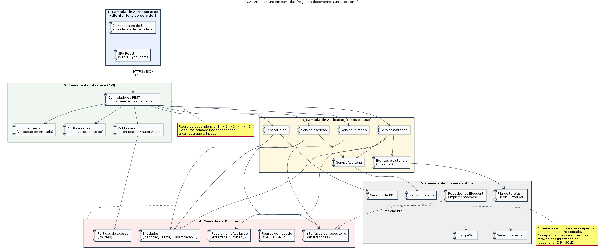
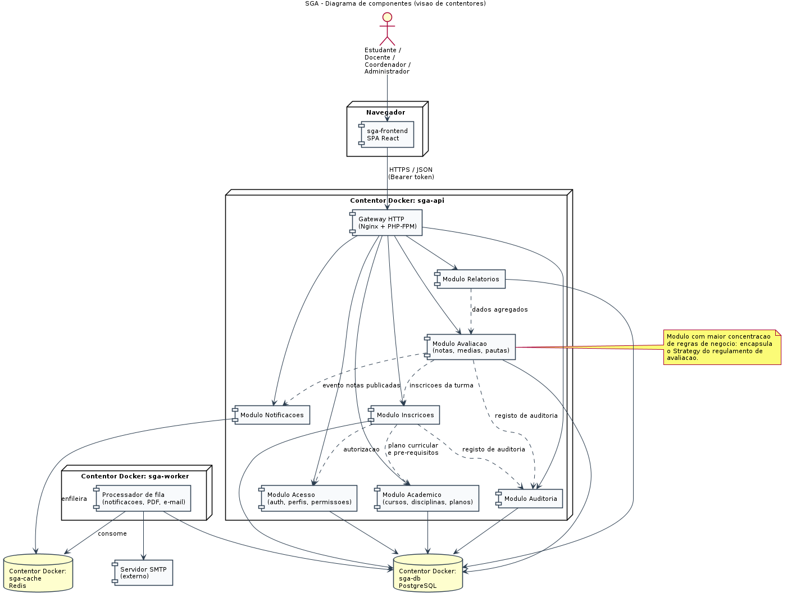
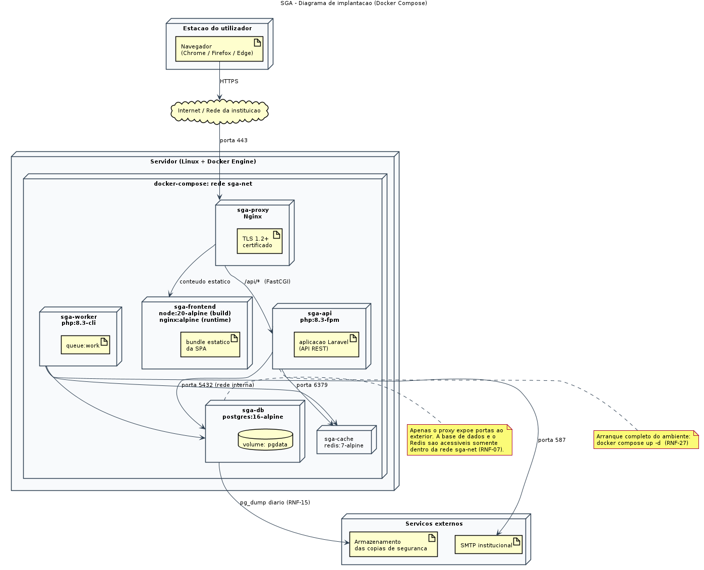
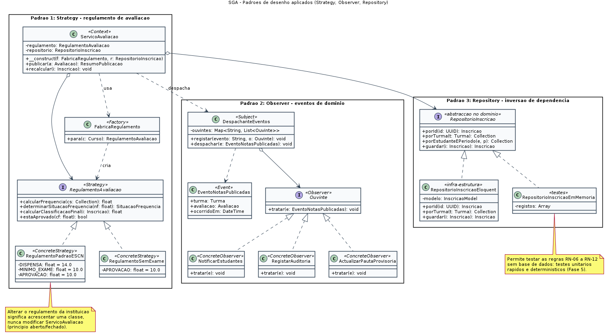

# Fase 3 — Arquitectura e Design

**Projecto 2 — Sistema de Gestão Académica (SGA)**
Escola Superior de Ciências Náuticas — Engenharia de Software
Curso: Programação de Sistemas Informáticos e de Telecomunicações
Grupo 2 — 3 estudantes | Maputo, 2026

Entrega correspondente ao período **22/09 – 01/10** do cronograma da disciplina.

---

## Índice

1. [Artefactos exigidos e onde estão](#1-artefactos-exigidos-e-onde-estão)
2. [Arquitectura do sistema](#2-arquitectura-do-sistema)
3. [Justificação da arquitectura escolhida](#3-justificação-da-arquitectura-escolhida)
4. [Stack tecnológico](#4-stack-tecnológico)
5. [Estrutura do repositório](#5-estrutura-do-repositório)
6. [Aplicação dos princípios SOLID](#6-aplicação-dos-princípios-solid)
7. [Padrões de desenho aplicados](#7-padrões-de-desenho-aplicados)
8. [Definição das principais APIs](#8-definição-das-principais-apis)
9. [Arquitectura de segurança](#9-arquitectura-de-segurança)
10. [Registo de decisões de arquitectura (ADR)](#10-registo-de-decisões-de-arquitectura-adr)
11. [Atributos de qualidade e tácticas](#11-atributos-de-qualidade-e-tácticas)
12. [Ficheiros entregues](#12-ficheiros-entregues)
13. [O que fica para a Fase 4](#13-o-que-fica-para-a-fase-4)

---

## 1. Artefactos exigidos e onde estão

| Artefacto obrigatório (enunciado, 4.3) | Entregue em | Secção |
|---|---|---|
| 1. Arquitectura do sistema | `diagramas/11`, `12`, `13` | 2 |
| 2. Justificação da arquitectura escolhida | este documento | 3 |
| 3. Aplicação dos princípios SOLID | este documento, com exemplos de código | 6 |
| 4. Aplicação de pelo menos um Design Pattern | `diagramas/14` (três padrões) | 7 |
| 5. Definição das principais APIs | `openapi.yaml` (validado) | 8 |
| 6. Justificação das principais decisões de design | ADR-001 a ADR-010 | 10 |

---

## 2. Arquitectura do sistema

### 2.1. Visão de camadas



O sistema segue uma **arquitectura em camadas com inversão de dependência**, organizada em
cinco níveis:

| # | Camada | Responsabilidade | O que **nunca** contém |
|---|---|---|---|
| 1 | Apresentação | SPA React: ecrãs, navegação, validação imediata de formulário | Regras de negócio (a validação no cliente é conveniência, nunca garantia) |
| 2 | Interface (API) | Controladores REST, autenticação, autorização, validação de entrada, serialização | Cálculos, consultas complexas, decisões de domínio |
| 3 | Aplicação | Serviços que orquestram casos de uso, transacções, disparo de eventos | Regras de cálculo (delegadas ao domínio), SQL |
| 4 | Domínio | Entidades, regras RN-01 a RN-12, políticas de acesso, interfaces de repositório | Qualquer referência a HTTP, Eloquent, PostgreSQL ou Redis |
| 5 | Infra-estrutura | Implementações de repositório, base de dados, filas, e-mail, PDF, logs | Decisões de negócio |

**Regra de dependência:** `1 → 2 → 3 → 4 ← 5`. A camada de domínio não depende de nenhuma
outra; a infra-estrutura depende do domínio por implementar as suas interfaces. Esta
inversão é o que permite testar as regras de avaliação sem base de dados (Fase 5) e é
verificável automaticamente no CI com uma regra de arquitectura.

### 2.2. Visão de componentes



A API está internamente dividida em sete módulos, com fronteiras explícitas. As dependências
entre módulos são unidireccionais e mínimas: `Inscricoes` conhece `Academico` (para o plano
curricular e os pré-requisitos) e `Acesso` (para autorização), mas `Academico` não conhece
`Inscricoes`. Nenhum módulo importa modelos de outro módulo directamente — a comunicação
faz-se por serviços públicos ou por eventos.

**Motivo desta divisão:** três estudantes a trabalhar em paralelo sobre o mesmo repositório.
Fronteiras claras entre módulos reduzem conflitos de fusão e permitem que cada membro avance
sem bloquear os outros (risco R3 e R4 da Fase 1).

### 2.3. Visão de implantação



Seis contentores orquestrados por Docker Compose: proxy, frontend, API, worker, base de dados
e cache. Apenas o proxy expõe portas ao exterior. O ambiente completo arranca com
`docker compose up -d` (RNF-27), requisito explícito do enunciado.

O contentor `sga-worker` existe para separar o trabalho assíncrono (notificações, geração de
PDF, envio de e-mail) do ciclo de pedido-resposta. Sem ele, a publicação de notas de uma
turma de 60 estudantes ficaria dependente da latência do servidor de e-mail.

---

## 3. Justificação da arquitectura escolhida

### 3.1. Alternativas consideradas

| Alternativa | Vantagens | Por que foi rejeitada |
|---|---|---|
| **MVC monolítico clássico** (controladores acedendo directamente aos modelos) | Rápido de implementar; menos ficheiros; familiar | As regras RN-06 a RN-12 acabariam dispersas por controladores e modelos, tornando-as impossíveis de testar isoladamente e de reutilizar entre a publicação de notas e a rectificação. O enunciado exige SOLID e testes automatizados — este estilo trabalha contra ambos. |
| **Microserviços** (serviços independentes para inscrições, avaliação, relatórios) | Escalabilidade independente; isolamento de falhas | Custo operacional desproporcionado: exigiria comunicação entre serviços, consistência distribuída e vários pipelines. Para 5 000 estudantes e uma equipa de três pessoas com prazo de um semestre, introduz risco sem benefício mensurável. |
| **Arquitectura hexagonal pura** (portas e adaptadores, domínio totalmente independente do framework) | Máximo isolamento do domínio; testabilidade excelente | Exigiria mapeamento manual entre entidades de domínio e modelos de persistência em todas as 20 tabelas. Custo de implementação incompatível com o cronograma; benefício marginal face à opção adoptada. |
| **Arquitectura em camadas com inversão de dependência** (adoptada) | Domínio isolado onde importa; testabilidade das regras críticas; alinhada com o framework escolhido | Exige disciplina de equipa: é possível violar as camadas por descuido. Mitigação: teste de arquitectura no CI. |

### 3.2. Fundamento da escolha

A decisão resulta de três factores concretos, e não de preferência estilística:

**1. A natureza do domínio.** O valor do sistema concentra-se em regras de cálculo e de
autorização que precisam de estar corretas e auditáveis. As regras de avaliação (RN-06 a
RN-12) são invocadas em três contextos distintos — publicação de notas, rectificação
aprovada e emissão de pauta. Uma arquitectura que não as isole obriga a triplicar a lógica,
o que é a origem clássica de resultados divergentes entre a pauta e a consulta do estudante:
exactamente o problema P2 da Fase 1.

**2. A composição da equipa.** Três estudantes com responsabilidades distintas (requisitos e
UML, implementação, testes e DevOps). Camadas com fronteiras explícitas permitem que o
Estudante 3 escreva testes contra interfaces antes de a implementação estar concluída, em
vez de esperar pelo fim da Fase 4.

**3. As exigências de avaliação.** O enunciado pontua explicitamente SOLID (5%), Design
Patterns (5%), testes (5%) e segurança (5%). A arquitectura escolhida torna estes quatro
critérios demonstráveis em código, não apenas afirmáveis no relatório.

### 3.3. Escolha da comunicação: API REST + SPA

O enunciado exige API REST. A separação entre a SPA React e a API traz três consequências
que interessam ao projecto:

- A API é testável sem interface, o que torna os testes de integração rápidos e determinísticos.
- A autorização é obrigatoriamente verificada no servidor: como o cliente é substituível, não
  há tentação de confiar na ocultação de botões (RNF-08).
- O mesmo *backend* serviria uma futura aplicação móvel, sem alterações — embora isso esteja
  fora do âmbito desta versão.

---

## 4. Stack tecnológico

| Camada | Tecnologia | Justificação |
|---|---|---|
| Frontend | React 18 + TypeScript + Vite | Tipagem estática reduz erros de integração com a API; Vite dá compilação rápida em máquinas modestas |
| Estilo | Tailwind CSS | Layout adaptativo sem folhas de estilo próprias (RNF-19) |
| Backend | PHP 8.3 + Laravel 11 | Fornece de origem autenticação, autorização por Policies, validação, migrações, filas, eventos e testes — componentes que de outro modo teríamos de construir, consumindo tempo do cronograma |
| Base de dados | PostgreSQL 16 | Tipos enumerados, índices parciais, `JSONB` para a auditoria, restrições `CHECK` expressivas e transacções robustas (usados no `schema.sql` da Fase 2) |
| Cache e filas | Redis 7 | Suporte a trabalho assíncrono e a cache de relatórios agregados |
| Testes | Pest (PHP) + Vitest (React) | Sintaxe concisa; cobertura integrada no CI (RNF-24) |
| Contentores | Docker + Docker Compose | Requisito do enunciado; garante reprodutibilidade do ambiente (RNF-27, RNF-29) |
| CI/CD | GitHub Actions | Integrado no repositório; sem custo; detalhado na Fase 6 |
| Documentação da API | OpenAPI 3.0 | Contrato executável entre frontend e backend (RNF-26) |

**Nota de honestidade técnica:** esta stack foi escolhida também porque a equipa já a domina.
Aprender um framework novo consumiria semanas que o cronograma não tem, e o enunciado avalia
a qualidade da engenharia — não a novidade das ferramentas. Todos os elementos são software
livre, cumprindo a restrição RE-02.

---

## 5. Estrutura do repositório

```
sga/
├── docker-compose.yml
├── docker/                       # Dockerfiles e configuração do Nginx
├── .github/workflows/ci.yml      # pipeline de CI/CD (Fase 6)
├── docs/
│   ├── fase1-requisitos.md
│   ├── fase2-modelacao.md
│   ├── fase3-arquitectura.md     # este documento
│   ├── openapi.yaml
│   ├── adr/                      # decisões de arquitectura
│   └── diagramas/                # fontes .puml e imagens
├── backend/
│   ├── app/
│   │   ├── Http/                 # CAMADA 2: controladores, middleware, requests, resources
│   │   │   ├── Controllers/Api/V1/
│   │   │   ├── Requests/
│   │   │   └── Resources/
│   │   ├── Servicos/             # CAMADA 3: casos de uso
│   │   │   ├── ServicoInscricao.php
│   │   │   ├── ServicoAvaliacao.php
│   │   │   ├── ServicoPauta.php
│   │   │   └── ServicoAuditoria.php
│   │   ├── Dominio/              # CAMADA 4: nada aqui importa Eloquent ou HTTP
│   │   │   ├── Entidades/
│   │   │   ├── Regras/
│   │   │   │   ├── ValidadorInscricao.php
│   │   │   │   └── Regulamento/
│   │   │   │       ├── RegulamentoAvaliacao.php      (interface)
│   │   │   │       ├── RegulamentoPadraoESCN.php
│   │   │   │       ├── RegulamentoSemExame.php
│   │   │   │       └── FabricaRegulamento.php
│   │   │   ├── Politicas/
│   │   │   └── Repositorios/     # interfaces (abstracções)
│   │   ├── Infraestrutura/       # CAMADA 5: implementações
│   │   │   ├── Repositorios/     # implementações Eloquent
│   │   │   ├── Pdf/
│   │   │   └── Notificacoes/
│   │   ├── Models/               # modelos Eloquent (persistência)
│   │   ├── Events/
│   │   └── Listeners/
│   ├── database/migrations/      # geradas a partir do schema.sql da Fase 2
│   ├── database/seeders/         # dados de demonstração (RNF-30)
│   ├── routes/api.php
│   └── tests/
│       ├── Unit/                 # regras de domínio, sem base de dados
│       ├── Feature/              # API, com base de dados
│       └── Arquitectura/         # verificação das regras de camadas
└── frontend/
    └── src/
        ├── paginas/
        ├── componentes/
        ├── servicos/api/         # cliente gerado a partir do openapi.yaml
        └── hooks/
```

A estrutura torna a arquitectura visível no sistema de ficheiros: a violação de camadas passa
a ser detectável numa revisão de *pull request* pelo simples caminho do ficheiro importado.

---

## 6. Aplicação dos princípios SOLID

Cada princípio é ilustrado com o caso concreto onde é aplicado no SGA, e com o que
aconteceria sem ele.

### S — Responsabilidade única (*Single Responsibility*)

O lançamento de notas envolve cinco responsabilidades distintas, atribuídas a cinco
colaboradores:

| Colaborador | Responsabilidade única |
|---|---|
| `ClassificacaoController` | Traduzir HTTP em chamadas de serviço e serializar a resposta |
| `LancarClassificacoesRequest` | Validar o formato da entrada (intervalo 0–20, UUID válido) |
| `PolicyAvaliacao` | Decidir se o utilizador pode agir sobre aquela turma |
| `ServicoAvaliacao` | Orquestrar a transacção, o recálculo e os eventos |
| `RegulamentoPadraoESCN` | Calcular frequência, situação e classificação final |

**Sem este princípio:** um método `publicar()` de 200 linhas no controlador, contendo
validação, autorização, cálculo e envio de e-mail — impossível de testar em unidade e
propenso a regressões a cada alteração de regulamento.

### O — Aberto/fechado (*Open/Closed*)

```php
// app/Dominio/Regras/Regulamento/RegulamentoAvaliacao.php
interface RegulamentoAvaliacao
{
    public function calcularFrequencia(Collection $classificacoes): float;
    public function determinarSituacaoFrequencia(float $nf): SituacaoFrequencia;
    public function calcularClassificacaoFinal(Inscricao $inscricao): float;
    public function estaAprovado(float $classificacaoFinal): bool;
}

// app/Dominio/Regras/Regulamento/RegulamentoPadraoESCN.php
final class RegulamentoPadraoESCN implements RegulamentoAvaliacao
{
    private const DISPENSA      = 14.0;   // RN-08
    private const MINIMO_EXAME  = 10.0;   // RN-09
    private const APROVACAO     = 10.0;   // RN-10

    public function calcularFrequencia(Collection $classificacoes): float
    {
        $somaPesos = $classificacoes->sum(fn ($c) => $c->avaliacao->peso);

        if (abs($somaPesos - 100.0) > 0.01) {
            throw new EstruturaAvaliacaoInvalida($somaPesos);   // RN-06
        }

        $ponderada = $classificacoes->sum(
            fn ($c) => $c->valorEfectivo() * $c->avaliacao->peso / 100
        );

        return round($ponderada, 1);   // RN-07
    }

    public function determinarSituacaoFrequencia(float $nf): SituacaoFrequencia
    {
        return match (true) {
            $nf >= self::DISPENSA     => SituacaoFrequencia::DISPENSADO,
            $nf >= self::MINIMO_EXAME => SituacaoFrequencia::ADMITIDO_EXAME,
            default                   => SituacaoFrequencia::REPROVADO_FREQUENCIA,
        };
    }
    // ...
}
```

Acrescentar o regulamento de um curso diferente significa criar uma classe nova. Nem
`ServicoAvaliacao`, nem os controladores, nem os testes existentes são modificados.

**Sem este princípio:** os limiares 14,0 e 10,0 apareceriam como literais em vários
`if` espalhados pelo código, e a mudança de regulamento exigiria caçá-los um a um — com
elevada probabilidade de deixar um para trás.

### L — Substituição de Liskov (*Liskov Substitution*)

Qualquer implementação de `RegulamentoAvaliacao` é substituível sem alterar o comportamento
esperado por `ServicoAvaliacao`. O contrato é respeitado em três aspectos: devolve sempre
um valor entre 0 e 20; nunca lança excepções não declaradas; nunca escreve na base de dados.

O mesmo se aplica aos repositórios: `RepositorioInscricaoEmMemoria` (usado nos testes) e
`RepositorioInscricaoEloquent` (produção) são intercambiáveis. Se o repositório em memória
se comportasse de modo diferente — por exemplo, devolvendo `null` onde o outro lança
excepção — os testes deixariam de provar o comportamento real, e o princípio estaria
violado na prática, ainda que a interface fosse formalmente cumprida.

### I — Segregação de interfaces (*Interface Segregation*)

Em vez de um `RepositorioAcademico` com trinta métodos, existem interfaces estreitas:

```php
interface RepositorioInscricao {
    public function porId(string $id): Inscricao;
    public function porTurma(Turma $turma): Collection;
    public function porEstudanteEPeriodo(string $estudanteId, int $periodoId): Collection;
    public function guardar(Inscricao $inscricao): Inscricao;
}

interface RepositorioClassificacao {
    public function porAvaliacao(int $avaliacaoId): Collection;
    public function guardarLote(Collection $classificacoes): void;
}
```

`ServicoPauta` depende de `RepositorioInscricao` e não fica exposto a métodos de escrita de
classificações que não usa. A consequência prática: ao alterar a assinatura de um método de
classificações, os testes de pautas não quebram.

### D — Inversão de dependência (*Dependency Inversion*)

```php
final class ServicoAvaliacao
{
    public function __construct(
        private readonly RepositorioInscricao $inscricoes,   // abstracção do domínio
        private readonly FabricaRegulamento $fabrica,
        private readonly ServicoAuditoria $auditoria,
        private readonly DespachanteEventos $eventos,
    ) {}

    public function publicar(Avaliacao $avaliacao): ResumoPublicacao
    {
        $regulamento = $this->fabrica->para($avaliacao->turma->disciplina->curso);
        // ...
    }
}
```

`ServicoAvaliacao` depende de interfaces, nunca de Eloquent. A ligação entre a abstracção e
a implementação concreta é declarada num único ponto (o *service provider*), o que permite
substituir a persistência nos testes com uma linha.

**Verificação automática.** Para que os princípios não fiquem apenas no relatório, o CI
executa um teste de arquitectura:

```php
test('o dominio nao depende da infra-estrutura')
    ->expect('App\Dominio')
    ->not->toUse(['Illuminate\Database', 'App\Models', 'App\Http']);

test('os controladores nao contem regras de negocio')
    ->expect('App\Http\Controllers')
    ->not->toUse(['App\Dominio\Regras\Regulamento']);
```

Uma violação de camadas faz a compilação falhar, em vez de ser descoberta na defesa.

---

## 7. Padrões de desenho aplicados



O enunciado exige pelo menos um padrão. Aplicam-se três, cada um resolvendo um problema
identificado nas fases anteriores — e não escolhidos por catálogo.

### 7.1. Strategy — regulamento de avaliação

| Aspecto | Descrição |
|---|---|
| **Problema** | As regras RN-06 a RN-12 são as mais voláteis do domínio (a Fase 2 deixou-as por confirmar) e podem variar por curso |
| **Solução** | Interface `RegulamentoAvaliacao` com implementações concretas, escolhidas em tempo de execução por `FabricaRegulamento` a partir de `cursos.regulamento_avaliacao` |
| **Alternativa rejeitada** | Cadeia de `if`/`switch` dentro de `ServicoAvaliacao`, ou herança com um `RegulamentoBase` — ambas obrigam a modificar código existente a cada novo regulamento |
| **Benefício mensurável** | Os limiares numéricos existem num único ficheiro, coberto por testes unitários de fronteira (9,95 / 10,0 / 13,94 / 14,0) |

### 7.2. Observer — eventos de domínio

| Aspecto | Descrição |
|---|---|
| **Problema** | A publicação de notas desencadeia acções heterogéneas: notificar estudantes, registar auditoria, invalidar a pauta provisória. Acrescentar acções não deve alterar o serviço de avaliação |
| **Solução** | `ServicoAvaliacao` despacha `EventoNotasPublicadas`; os ouvintes (`NotificarEstudantes`, `RegistarAuditoria`, `ActualizarPautaProvisoria`) reagem de forma independente |
| **Decisão importante** | O evento é despachado **após** a confirmação da transacção, e o envio de notificações corre na fila. Uma falha no servidor de e-mail não anula a publicação das notas (US-18, fluxo A5) |
| **Alternativa rejeitada** | Chamada directa ao serviço de notificações dentro do serviço de avaliação: acopla a publicação à disponibilidade do SMTP |

### 7.3. Repository — inversão da persistência

| Aspecto | Descrição |
|---|---|
| **Problema** | Testar as regras de cálculo exigiria base de dados, tornando os testes lentos e dependentes de estado |
| **Solução** | Interfaces de repositório declaradas no domínio, com implementação Eloquent na infra-estrutura e implementação em memória nos testes |
| **Custo assumido** | Mais uma camada de indirecção e algum código adicional. Aceitável apenas onde há lógica a proteger — os cadastros simples (CRUD de disciplinas) usam Eloquent directamente, sem repositório |
| **Benefício** | Os testes das regras RN-06 a RN-12 correm em milissegundos, o que os torna executáveis a cada *commit* |

**Nota sobre pragmatismo:** aplicar Repository a todas as 20 tabelas seria dogmatismo com
custo real de tempo. O padrão é usado nas quatro entidades onde existe lógica de negócio
(inscrições, classificações, avaliações, pautas) e dispensado nos cadastros. Esta é uma
decisão consciente, registada em ADR-006, e será defendida como tal.

---

## 8. Definição das principais APIs

A especificação completa está em **`openapi.yaml`** — validada contra o esquema OpenAPI 3.0
(27 rotas, 27 esquemas de dados).

### 8.1. Convenções transversais

| Convenção | Regra adoptada |
|---|---|
| Versionamento | Prefixo no caminho: `/api/v1/...` |
| Nomes de recursos | Substantivos no plural: `/estudantes`, `/inscricoes`, `/turmas` |
| Sub-recursos | Relação expressa no caminho: `/turmas/{id}/avaliacoes`, `/estudantes/{id}/aproveitamento` |
| Acções de domínio | Quando a operação não é um CRUD, usa-se um sub-recurso verbal explícito: `POST /avaliacoes/{id}/publicar`, `POST /pautas/{id}/homologar`, `POST /rectificacoes/{id}/decisao` |
| Paginação | `?pagina=&por_pagina=` com máximo de 50 (RNF-04); resposta com `total` e `total_paginas` |
| Idempotência | `PUT /avaliacoes/{id}/classificacoes` substitui o conjunto de rascunhos; repetir o pedido produz o mesmo estado |
| Autenticação | `Authorization: Bearer <token>`; nenhuma rota de negócio é anónima |
| Formato de data | ISO 8601 com fuso horário (RNF-34) |

### 8.2. Códigos de estado e semântica

| Código | Uso no SGA | Exemplo |
|---|---|---|
| 200 | Consulta ou actualização bem-sucedida | `GET /estudantes` |
| 201 | Recurso criado | `POST /inscricoes` |
| 204 | Operação sem conteúdo de resposta | `DELETE /inscricoes/{id}` |
| 401 | Sem autenticação válida | Token ausente ou expirado |
| 403 | Autenticado, sem permissão | Docente a tentar acessar turma alheia |
| 404 | Recurso inexistente | Estudante eliminado logicamente |
| 409 | Conflito de estado do recurso | Publicar pauta incompleta; anular inscrição com notas publicadas |
| 422 | Entrada inválida ou regra de negócio violada | Nota de 21; pré-requisito não satisfeito |
| 423 | Conta bloqueada temporariamente | 5 tentativas de autenticação falhadas |

**Distinção deliberada entre 409 e 422:** 422 indica que os dados enviados são inaceitáveis;
409 indica que os dados estão corretos mas o estado actual do recurso impede a operação. A
distinção permite ao frontend reagir de forma diferente — corrigir o formulário, ou explicar
o estado.

### 8.3. Formato dos erros de negócio

Os erros de regra de negócio incluem o **código da regra**, o que os torna rastreáveis à
Fase 1 e testáveis:

```json
{
  "codigo": "RN-02",
  "mensagem": "Pré-requisito não satisfeito: Programação I (INF101) não aprovada.",
  "campo": "turmas.0"
}
```

Nenhuma resposta de erro inclui *stack traces*, nomes de tabelas ou consultas SQL (RNF-17).

### 8.4. Endpoints por caso de uso crítico

| Caso de uso | Endpoint | Observação |
|---|---|---|
| UC14 — Inscrever-se | `GET /inscricoes/disponiveis` seguido de `POST /inscricoes` | O primeiro devolve só turmas elegíveis; o segundo revalida tudo no servidor. A pré-filtragem é usabilidade, não segurança |
| UC20 — Lançar notas | `PUT /avaliacoes/{id}/classificacoes` | Lote e idempotente: suporta gravação parcial em ligações instáveis (PR-04) |
| UC21 — Publicar | `POST /avaliacoes/{id}/publicar` | Devolve resumo agregado, não a lista de notas (RNF-05) |
| UC24 — Decidir rectificação | `POST /rectificacoes/{id}/decisao` | Uma única rota para aprovar e recusar, com `decisao` no corpo: a decisão é um acto, não dois recursos |
| UC25 — Aproveitamento | `GET /estudantes/{id}/aproveitamento` | Autorização por Policy: próprio, curso coordenado, ou Administrador |
| UC31 — Auditoria | `GET /auditoria` | Recurso exclusivamente de leitura; não existe `POST`, `PUT` ou `DELETE` (RNF-32) |

### 8.5. Contrato como ferramenta de trabalho paralelo

O `openapi.yaml` é escrito **antes** da implementação e serve três propósitos práticos: gerar
o cliente TypeScript do frontend, permitir que o frontend avance com dados simulados enquanto
o backend é construído, e servir de base aos testes de contrato na Fase 5. É o que torna
viável o trabalho em paralelo de três pessoas durante a Fase 4.

---

## 9. Arquitectura de segurança

Aplica-se defesa em profundidade: a mesma regra é verificada em mais de uma camada, com a
verificação decisiva sempre no servidor.

| Camada | Mecanismo | Requisito |
|---|---|---|
| Transporte | HTTPS/TLS 1.2+ terminado no proxy; base de dados e Redis inacessíveis do exterior | RNF-07 |
| Autenticação | Token Bearer com expiração de 60 minutos e *refresh*; palavras-passe em bcrypt | RNF-06, RNF-11 |
| Autorização | Middleware de permissão nas rotas + Policy por recurso (o docente só age sobre as suas turmas) | RNF-08, RNF-12 |
| Entrada | Form Requests validam tipo, intervalo e formato antes de o pedido chegar ao domínio | RNF-10 |
| Consultas | Exclusivamente parametrizadas via ORM — nenhuma concatenação de SQL | OWASP A03 |
| Saída | Serialização por API Resources: os campos expostos são declarados explicitamente, evitando fuga acidental de colunas | RNF-12 |
| Identificadores | UUID nos recursos com dados pessoais, impedindo enumeração | RNF-12 |
| Auditoria | Registo imutável, garantido por *trigger* na base de dados | RNF-31, RNF-32 |
| Segredos | Variáveis de ambiente; `.env` excluído por `.gitignore` | RNF-13 |
| Erros | Mensagens genéricas ao cliente, detalhe apenas no log do servidor | RNF-17 |

### 9.1. Cobertura do OWASP Top 10

| Risco | Táctica adoptada |
|---|---|
| A01 — Controlo de acesso deficiente | Policy por recurso; testes automatizados que tentam acessos indevidos por perfil |
| A02 — Falhas criptográficas | bcrypt para palavras-passe; TLS obrigatório; nenhum dado sensível em logs |
| A03 — Injecção | ORM com consultas parametrizadas; validação de todas as entradas |
| A04 — Desenho inseguro | Notas publicadas imutáveis; rectificação exige aprovação de segunda pessoa |
| A05 — Configuração incorrecta | `APP_DEBUG=false` em produção; imagens base mínimas (Alpine); portas fechadas |
| A07 — Falhas de autenticação | Bloqueio após 5 tentativas; token com expiração; mesma resposta para e-mail existente e inexistente |
| A08 — Falhas de integridade | Versões fixadas no `composer.lock` e `package-lock.json`; imagens Docker com tag exacta |
| A09 — Falhas de registo | Auditoria de operações sensíveis e de tentativas de autenticação falhadas |

Os pontos A06 (componentes vulneráveis) e A10 (SSRF) são tratados na Fase 6, com análise de
dependências no pipeline.

---

## 10. Registo de decisões de arquitectura (ADR)

Formato condensado. Cada decisão registra contexto, opção tomada e consequência aceite.

| ID | Decisão | Contexto e alternativas | Consequência aceite |
|---|---|---|---|
| **ADR-001** | Arquitectura em camadas com inversão de dependência | Alternativas: MVC clássico, microserviços, hexagonal pura (secção 3.1) | Exige disciplina de camadas; mitigada por teste de arquitectura no CI |
| **ADR-002** | Laravel 11 + PostgreSQL 16 | A equipa domina a stack; o framework fornece autenticação, filas e eventos prontos | Dependência do ciclo de vida do framework; aceitável para o horizonte do projecto |
| **ADR-003** | API REST com SPA React separada | Exigido pelo enunciado; permite testar a API sem interface | Duas aplicações a construir e a implantar; mitigado pelo Docker Compose |
| **ADR-004** | Regulamento de avaliação como Strategy | As regras são voláteis e variam por curso | Uma indirecção adicional; justificada pela testabilidade |
| **ADR-005** | Notificações via eventos e fila (Observer) | O envio síncrono acoplaria a publicação de notas ao SMTP | Necessidade de um contentor `worker` e monitorização da fila |
| **ADR-006** | Repository apenas nas entidades com lógica de negócio | Aplicá-lo a tudo custaria tempo sem benefício nos CRUD simples | Assimetria de estilo entre módulos; documentada para evitar leitura como incoerência |
| **ADR-007** | Resultado consolidado persistido na inscrição | Recálculo permanente inviabilizaria o desempenho dos relatórios (RNF-01, RNF-03) | Desnormalização controlada; recálculo concentrado num único serviço |
| **ADR-008** | Regras críticas duplicadas no domínio e na base de dados | Concorrência na última vaga e acesso directo à base de dados | Duplicação deliberada de RN-03, RN-04 e RN-11; documentada na Fase 2 |
| **ADR-009** | UUID nos recursos com dados pessoais | Identificadores sequenciais permitem enumeração via API | Índices maiores e URLs menos legíveis |
| **ADR-010** | Contrato OpenAPI escrito antes da implementação | Três pessoas a trabalhar em paralelo na Fase 4 | O contrato tem de ser mantido actualizado; verificado por testes de contrato na Fase 5 |

---

## 11. Atributos de qualidade e tácticas

Ligação directa entre os requisitos não funcionais da Fase 1 e as decisões desta fase.

| Atributo | Requisito | Táctica arquitectural |
|---|---|---|
| Desempenho | RNF-01, RNF-02, RNF-03 | Índices dirigidos às consultas reais; paginação obrigatória; vistas para agregações; cache Redis nos relatórios; resposta agregada na publicação |
| Segurança | RNF-06 a RNF-13 | Defesa em profundidade (secção 9); autorização por Policy; UUID nos recursos sensíveis |
| Fiabilidade | RNF-14 a RNF-17 | Transacções em todas as operações multi-escrita; trabalho assíncrono isolado no worker; cópias de segurança diárias |
| Manutenibilidade | RNF-22 a RNF-26 | Camadas com fronteiras verificadas no CI; SOLID; contrato OpenAPI; *linter* obrigatório |
| Testabilidade | RNF-24 | Inversão de dependência; repositório em memória; domínio sem infra-estrutura |
| Portabilidade | RNF-27 a RNF-30 | Containerização completa; `seeders` de demonstração; variáveis de ambiente |
| Usabilidade | RNF-18 a RNF-21 | Erros com código de regra e mensagem explicativa; gravação parcial de notas; respostas leves |

---

## 12. Ficheiros entregues

```
fase3/
├── Fase3_Arquitectura_Design_SGA.md      (este documento)
├── openapi.yaml                          (27 rotas, validado contra OpenAPI 3.0)
└── diagramas/
    ├── 11-arquitectura-camadas.puml      → arquitectura-camadas.png|svg
    ├── 12-componentes.puml               → componentes.png|svg
    ├── 13-implantacao.puml               → implantacao.png|svg
    └── 14-padroes-design.puml            → padroes-design.png|svg
```

**Validar a especificação da API:**

```bash
pip install openapi-spec-validator
python -c "from openapi_spec_validator import validate; \
from openapi_spec_validator.readers import read_from_filename; \
validate(read_from_filename('openapi.yaml')[0]); print('válido')"
```

**Visualizar a documentação da API:**

```bash
docker run -p 8080:8080 -e SWAGGER_JSON=/spec/openapi.yaml \
  -v $(pwd):/spec swaggerapi/swagger-ui
```

---

## 13. O que fica para a Fase 4

A Fase 4 (06/10 – 15/10) começa com a estrutura já decidida. Ordem de trabalho proposta,
alinhada com o backlog da Fase 1:

1. **Esqueleto e ambiente** — `docker compose up` a funcionar com Laravel, PostgreSQL, Redis
   e a SPA a servir uma página autenticada. Responsável: Estudante 3, imediatamente, para não
   repetir o risco R4.
2. **Migrações a partir do `schema.sql`** — converter em migrações versionadas, mantendo as
   restrições e os *triggers*.
3. **Módulo Acesso** — autenticação, perfis, permissões, Policies e os testes de acesso
   indevido. Nada avança antes disto, porque tudo depende dele.
4. **Cadastros estruturantes** — cursos, disciplinas, plano curricular, turmas.
5. **Inscrições** — `ValidadorInscricao` com as cinco regras, cada uma com o seu teste.
6. **Avaliação** — `RegulamentoPadraoESCN` com os testes de fronteira antes do controlador.

**Duas dependências externas que continuam em aberto** e devem ser resolvidas antes do
ponto 6: a confirmação do regulamento de avaliação real junto do Coordenador e a definição
do peso relativo entre frequência e exame na classificação final. O Strategy limita o
impacto, mas não elimina a necessidade da resposta.

---

## Controlo do documento

| Versão | Data | Autores | Alterações |
|---|---|---|---|
| 1.0 | 2026-09-XX | Grupo 2 | Versão inicial da Fase 3 — Arquitectura e Design |

**Documento anterior:** Fase 2 — Modelação
**Documento seguinte:** Fase 4 — Implementação (06/10 – 15/10)
